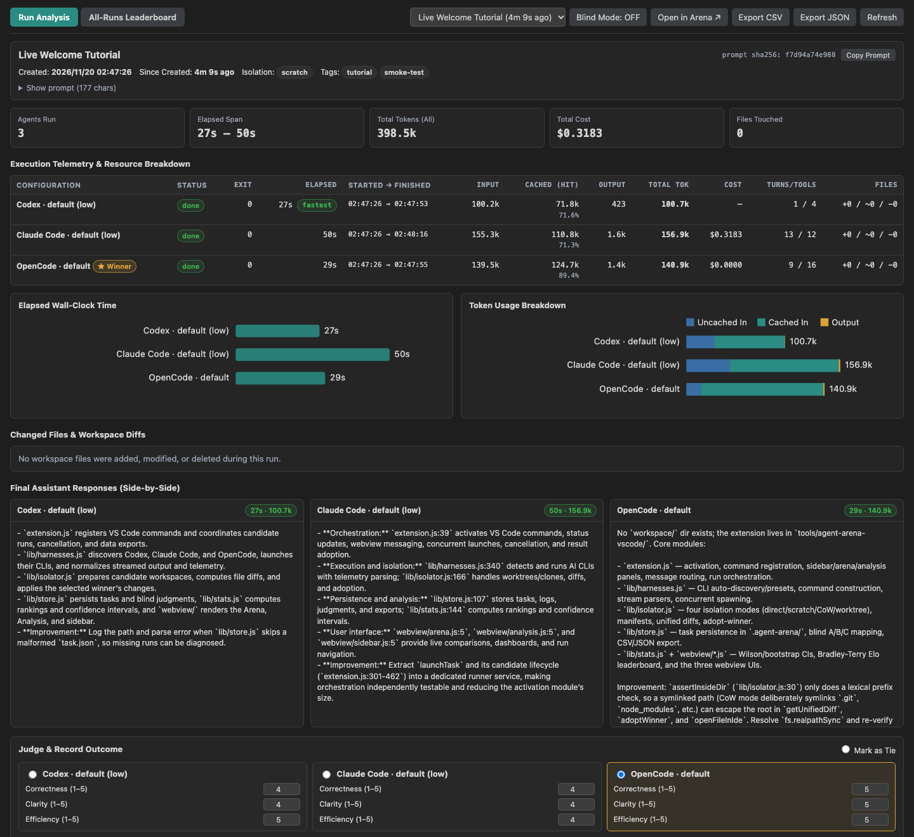
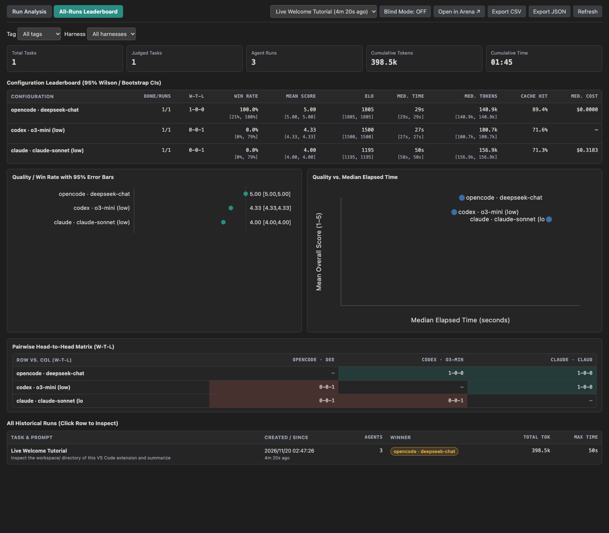

# Agent Arena

**Run multiple AI coding harnesses, models, and reasoning efforts side-by-side in VS Code — compare live execution, token telemetry, elapsed time, diffs, and blind outcomes.**

[](https://github.com/Osgood001/agent-arena-vscode/actions/workflows/ci.yml)
[](LICENSE)
[](https://code.visualstudio.com/)

Agent Arena gives you a medium-agnostic benchmark cockpit right inside VS Code. Toggle any combination of locally installed agent CLIs (`codex`, `claude`, `opencode`, `pi`, `dsh`, or custom shell commands), launch one shared prompt concurrently across side-by-side columns, monitor real-time streams and token burn, and evaluate results blindly with confidence intervals and Bradley-Terry Elo rankings.

---

## Side-by-Side Live Arena

Select presets or custom `(harness, model, effort)` columns, launch one prompt concurrently (`Cmd+Enter` / `Ctrl+Enter`), filter each pane's stream (`All` / `Tools` / `Errors`), track live ticking clocks and token telemetry, and jump straight to Analysis when finished.


## Analysis & Telemetry Dashboard

Inspect per-run execution KPIs, input/cached/output/reasoning token breakdowns, cache hit rates, elapsed wall-clock comparisons, workspace diffs (with native `vscode.diff`), blind A/B/C judging, and a persistent cross-task leaderboard.



### All-Runs Leaderboard & Statistical Ranking

Track rolling performance across prompts with Wilson 95% confidence intervals on win rate, bootstrap 95% CIs on scores/duration/tokens, Laplace-smoothed Bradley-Terry Elo, Pareto latency-vs-quality plots, and pairwise win-tie-loss matrices.



---

## Key Features

- **Unified Concurrent Side-by-Side Columns**: Every `(harness, model, effort)` configuration runs in parallel in one panel, with per-pane status badges, ticking timers, live feeds, raw logs, final response tabs, and per-pane `All | Tools | Errors` filters.
- **Built-in Live Welcome Tutorial**: First-time setup guides you through a *real* multi-agent execution (not a canned replay) on your workspace and walks through Analysis & Blind Judging.
- **Zero-Config Local Auto-Discovery**: When `agentArena.presets` is empty (default), Agent Arena automatically inspects non-secret default model and effort fields from `~/.codex/config.toml`, `~/.claude/settings.json`, `~/.config/opencode/opencode.json`, and `~/.pi/agent/settings.json`.
- **Four Execution Isolation Modes**:
  - `direct` *(default)*: Runs all selected agents directly in the shared workspace with instant startup and shared-workspace change badges.
  - `scratch`: Gives each candidate an instant isolated working folder with a `workspace` symlink back to your project root.
  - `apfs-cow`: Cross-platform copy-on-write clone (`cp -cRP` on macOS, `cp --reflink=auto` on Linux, size-guarded fallback) that automatically symlinks heavy directories (`node_modules`, `.venv`, `.git`, directories >250 entries).
  - `git-worktree`: Creates detached `git worktree` checkouts per candidate for clean per-agent diffs and one-click `Adopt into Workspace`.
- **Blind Evaluation & Telemetry Export**: Shuffles candidate identities as `Candidate A/B/C` during judging, stores scores/notes in `.agent-arena/tasks/<id>/task.json`, and exports complete CSV/JSON datasets.

---

## Supported Harnesses

| Harness | CLI Binary | Telemetry Captured | Config Discovery |
|---|---|---|---|
| **Codex** (`codex`) | `codex` | Input, cached, output & reasoning tokens, turns, shell/file/MCP/web search tool calls | `~/.codex/config.toml` |
| **Claude Code** (`claude`) | `claude` | Live & authoritative turns, input/cache/output/reasoning tokens, USD cost, tool calls, permission notices | `~/.claude/settings.json` |
| **OpenCode** (`opencode`) | `opencode` | Step turns, input/cache/output/reasoning tokens, USD cost, tool calls & errors | `~/.config/opencode/opencode.json` |
| **Pi** (`pi`) | `pi` | Turns, input/cache/output tokens, USD cost, tool execution events | `~/.pi/agent/settings.json` |
| **DeepSeek Harness** (`dsh`) | `dsh` | Streamed output, filtered Node warnings, elapsed timing | `headless` profile |
| **Custom Shell** (`custom`) | `/bin/sh` or `cmd.exe` | Supports `{prompt_file}`, `{cwd}`, `{model}`, `{effort}` template variables | Per-column config |

---

## Installation

### From VS Code Marketplace
Search for **Agent Arena** (`Osgood001.agent-arena`) in the VS Code Extensions view, or install via CLI:

```sh
code --install-extension Osgood001.agent-arena
```

### From GitHub Releases (`.vsix`)
Download the latest `.vsix` from [Releases](https://github.com/Osgood001/agent-arena-vscode/releases) and install locally:

```sh
code --install-extension agent-arena-0.3.0.vsix --force
```

---

## Quick Start

1. Open the **Agent Arena** icon in the VS Code Activity Bar.
2. Click **Open Side-by-Side Arena** (or **Live Welcome Tutorial** for a guided 3-CLI run).
3. Toggle agent preset chips at the top or click **+ Custom** to add any harness/model/effort column.
4. Pick an isolation mode (`Direct`, `Scratch`, `CoW Clone`, or `Git Worktree`), enter your prompt, and press `Cmd+Enter` (`Ctrl+Enter`).
5. Click **Open Analysis & Telemetry** when settled to compare metrics, inspect diffs, judge blindly, or export CSV/JSON.

---

## Extension Settings

| Setting | Default | Description |
|---|---|---|
| `agentArena.presets` | `[]` | Custom `(harness, model, effort)` presets; empty auto-discovers local CLI defaults. |
| `agentArena.defaultIsolationMode` | `"direct"` | Default isolation mode (`direct`, `scratch`, `apfs-cow`, `git-worktree`). |
| `agentArena.maxConcurrency` | `6` | Maximum concurrent candidate processes per task (`1–12`). |
| `agentArena.timeoutMinutes` | `30` | Per-agent execution timeout in minutes. |
| `agentArena.symlinkDirs` | `["node_modules", ".venv", ...]` | Heavy top-level directories symlinked in CoW mode and skipped in fast manifests. |
| `agentArena.claudePermissionMode` | `"acceptEdits"` | Permission flag passed to Claude Code (`acceptEdits`, `bypassPermissions`, `auto`). |
| `agentArena.codexSandboxMode` | `"workspace-write"` | Sandbox flag passed to Codex CLI (`workspace-write`, `danger-full-access`, `read-only`). |
| `agentArena.opencodeAuto` | `true` | Pass `--auto` to OpenCode non-interactive runs. |

---

## Development, Testing & Publishing

```sh
npm test                 # Run unit, parser, git-worktree, diff, webview & extension tests
npm run package          # Validate & package .vsix using @vscode/vsce
```

### Publishing to the VS Code Marketplace

Pushing a tag matching `v*` triggers `.github/workflows/publish.yml` to test, package, create a GitHub Release with the `.vsix`, and publish to the VS Code Marketplace when `VSCE_PAT` is set:

```sh
gh secret set VSCE_PAT --repo Osgood001/agent-arena-vscode
# or publish manually with an Azure DevOps Marketplace PAT:
npx @vscode/vsce publish -p <YOUR_VSCE_PAT>
```

---

## License

[MIT](LICENSE)
