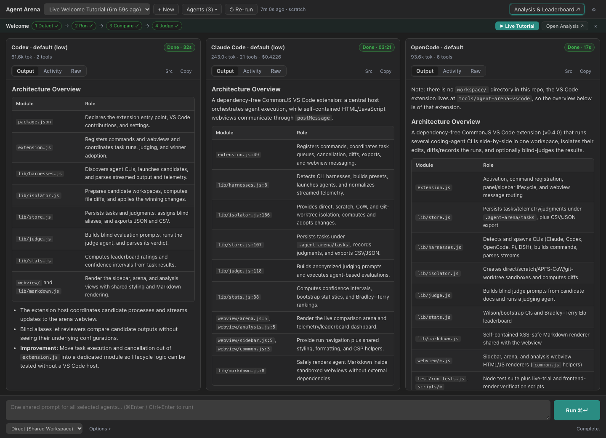

# Agent Arena

**Run multiple AI coding harnesses, models, and reasoning efforts side-by-side in VS Code — minimalist output comparison, rendered Markdown, AI-agent judging, and clean leaderboards.**

[](https://github.com/Osgood001/agent-arena-vscode/actions/workflows/ci.yml)
[](LICENSE)
[](https://code.visualstudio.com/)

Agent Arena gives you a calm, output-first benchmark cockpit right inside VS Code. Toggle any combination of locally installed agent CLIs (`codex`, `claude`, `opencode`, `pi`, `dsh`, or custom shell commands), launch one shared prompt concurrently across side-by-side columns, read rendered Markdown outputs (including generated `.md` files), run an automated AI judge or judge blindly yourself, and track clean Elo rankings with deeper telemetry one click away.

---

## Side-by-Side Live Arena

Minimalist workspace focused on agent output: auto-switches from live activity streams while running to rendered Markdown when settled, supports switching directly into `.md` artifacts produced in isolated runs, and tucks preset drawers and options cleanly out of the way.



## Clean Analysis & Configurable AI Agent Judge

Review rendered Markdown responses side-by-side alongside a compact 5-column summary, evaluate outputs manually or click **Run AI Judge** using any configured coding agent (with optional blind candidate masking and custom rubric), and expand **Detailed Telemetry, Charts & Workspace Diffs** whenever you want full resource tables, token plots, or `vscode.diff` comparisons.


### Clean Leaderboard & Expandable Statistics

Uncluttered primary leaderboard (`Rank`, `Configuration`, `Elo`, `Win Rate`, `Avg Score`, `Median Time · Tokens`) with **Statistical Details, 95% CIs, Plots & Pairwise Matrix** tucked cleanly into a collapsible disclosure.


---

## Key Features

- **Minimalist Output-First Design**:
  - Smart Arena view shows `Activity` while an agent runs and switches automatically to formatted `Output` once settled.
  - Progressive disclosure keeps deep 12-column telemetry, SVG elapsed/token/forest/Pareto charts, Wilson/bootstrap 95% CIs, pairwise win matrices, and CSV/JSON export out of the way until you expand them.
- **Rendered Markdown & Artifact Preview**:
  - Zero-dependency, XSS-safe GitHub-Flavored Markdown renderer (headings, tables, fenced code blocks, task checkboxes, blockquotes, lists, sanitized links) with one-click `MD` / `Src` toggle.
  - Inspect generated `.md` / `.markdown` files directly inside Arena panes or Analysis response cards, or open them in VS Code (`Open ↗`).
- **Configurable Coding Agent as Judge**:
  - Assign `codex`, `claude`, `opencode`, `pi`, `dsh`, or a `custom` shell template as judge via UI controls or `agentArena.judge.*` settings.
  - Blindly masks submissions as `Candidate A/B/C` by default, attaches `.md` output files from isolated runs, accepts custom rubrics, persists scores and rationale (`⚡ AI Judge` provenance), and lets you review/adjust before saving.
- **Zero-Config Local Auto-Discovery**: When `agentArena.presets` is empty (default), Agent Arena safely inspects non-secret default model and effort fields from `~/.codex/config.toml`, `~/.claude/settings.json`, `~/.config/opencode/opencode.json`, and `~/.pi/agent/settings.json`.
- **Four Execution Isolation Modes**:
  - `direct` *(default)*: Instant shared workspace execution.
  - `scratch`: Instant per-agent working folder with a `workspace` symlink back to your project root.
  - `apfs-cow`: Cross-platform CoW clone (`cp -cRP` on macOS, `cp --reflink=auto` on Linux, size-guarded fallback) that automatically symlinks heavy directories (`node_modules`, `.venv`, `.git`, directories >250 entries).
  - `git-worktree`: Detached `git worktree` per agent with clean per-agent diffs and one-click `Adopt Winner Files`.

---

## Supported Harnesses

| Harness | CLI Binary | Telemetry Captured | Config Discovery |
|---|---|---|---|
| **Codex** (`codex`) | `codex` | Input, cached, output & reasoning tokens, turns, shell/file/MCP/web search tool calls | `~/.codex/config.toml` |
| **Claude Code** (`claude`) | `claude` | Live & authoritative turns, input/cache/output/reasoning tokens, USD cost, tool calls, permission notices | `~/.claude/settings.json` |
| **OpenCode** (`opencode`) | `opencode` | Step turns, input/cache/output/reasoning tokens, USD cost, tool calls & errors | `~/.config/opencode/opencode.json` |
| **Pi** (`pi`) | `pi` | Turns, input/cache/output tokens, USD cost, tool execution events | `~/.pi/agent/settings.json` |
| **DeepSeek Harness** (`dsh`) | `dsh` | Streamed output, filtered Node warnings, elapsed timing | `headless` profile |
| **Custom Shell** (`custom`) | `/bin/sh` or `cmd.exe` | Supports `{prompt_file}`, `{cwd}`, `{model}`, `{effort}` template variables | Per-column config |

---

## Installation

### From VS Code Marketplace
Search for **Agent Arena** (`Osgood001.agent-arena`) in the VS Code Extensions view, or install via CLI:

```sh
code --install-extension Osgood001.agent-arena
```

### From GitHub Releases (`.vsix`)
Download the latest `.vsix` from [Releases](https://github.com/Osgood001/agent-arena-vscode/releases) and install locally:

```sh
code --install-extension agent-arena-0.4.0.vsix --force
```

---

## Extension Settings

| Setting | Default | Description |
|---|---|---|
| `agentArena.presets` | `[]` | Custom `(harness, model, effort)` presets; empty auto-discovers local CLI defaults. |
| `agentArena.defaultIsolationMode` | `"direct"` | Default isolation mode (`direct`, `scratch`, `apfs-cow`, `git-worktree`). |
| `agentArena.maxConcurrency` | `6` | Maximum concurrent candidate processes per task (`1–12`). |
| `agentArena.timeoutMinutes` | `30` | Per-agent execution timeout in minutes. |
| `agentArena.symlinkDirs` | `["node_modules", ".venv", ...]` | Heavy top-level directories symlinked in CoW mode and skipped in fast manifests. |
| `agentArena.claudePermissionMode` | `"acceptEdits"` | Permission flag passed to Claude Code (`acceptEdits`, `bypassPermissions`, `auto`). |
| `agentArena.codexSandboxMode` | `"workspace-write"` | Sandbox flag passed to Codex CLI (`workspace-write`, `danger-full-access`, `read-only`). |
| `agentArena.opencodeAuto` | `true` | Pass `--auto` to OpenCode non-interactive runs. |
| `agentArena.judge.harness` | `""` | Coding agent harness assigned to judge runs (`""` = auto-pick first available CLI). |
| `agentArena.judge.model` | `""` | Model passed to the judge agent (`""` = CLI default). |
| `agentArena.judge.effort` | `"medium"` | Reasoning effort passed to the judge agent when supported. |
| `agentArena.judge.blind` | `true` | Mask submissions as `Candidate A/B/C` during AI judging. |
| `agentArena.judge.rubric` | `""` | Optional custom evaluation rubric appended to the AI judge prompt. |

---

## Development, Testing & Publishing

```sh
npm test                 # Run markdown, AI judge, parser, git-worktree, diff, webview & extension tests
npm run package          # Validate & package .vsix using @vscode/vsce
```

Pushing a tag matching `v*` triggers `.github/workflows/publish.yml` to test, package, create a GitHub Release with the `.vsix`, and publish to the VS Code Marketplace when `VSCE_PAT` is set:

```sh
gh secret set VSCE_PAT --repo Osgood001/agent-arena-vscode
# or publish manually with an Azure DevOps Marketplace PAT:
npx @vscode/vsce publish -p <YOUR_VSCE_PAT>
```

---

## License

[MIT](LICENSE)
